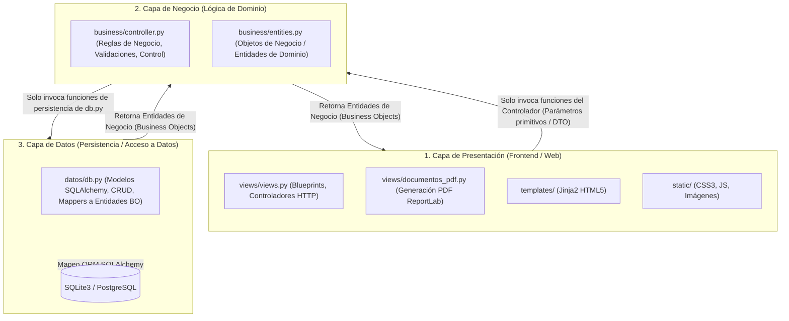

# 🏗️ 2. Arquitectura en Capas del Sistema

**InmoGestión B2B - Sistema Integral de Gestión Inmobiliaria**  
*Cátedra: Soporte a la Gestión con Tecnologías de la Información / Python*  
*Universidad Tecnológica Nacional - Facultad Regional Rosario (UTN FRRO)*

---

## 📐 Fundamento y Patrón Arquitectónico

El sistema **InmoGestión B2B** fue concebido y estructurado respetando estrictamente el patrón de **Arquitectura en 3 Capas Desacopladas**. Este diseño garantiza:
- **Alta Cohesión:** Cada capa agrupa componentes con propósitos funcionales estrechamente vinculados.
- **Bajo Acoplamiento:** Los cambios en una capa (como la sustitución del motor de base de datos o el reemplazo del framework web) no comprometen el funcionamiento de las demás.
- **Mantenibilidad y Escalabilidad:** Facilita la incorporación de nuevas funcionalidades y reglas de negocio sin introducir efectos colaterales.
- **Testabilidad Aislada:** La lógica de negocio puede ser testeada unitariamente con Pytest sin necesidad de levantar un servidor web ni contar con una base de datos física persistente.

---

## 🔄 Flujo Unidireccional de Dependencias

El flujo de control y llamadas es estrictamente descendente y unidireccional:
$$\text{Presentación} \longrightarrow \text{Negocio} \longrightarrow \text{Datos}$$

---

## 🏛️ Detalle y Responsabilidad de cada Capa

### 1. Capa de Presentación (`views/`, `templates/`, `static/`)
- **Ubicación:** 
  - [`views/views.py`](file:///views/views.py)
  - [`views/documentos_pdf.py`](file:///views/documentos_pdf.py)
  - Directorio `templates/` (vistas HTML Jinja2)
  - Directorio `static/` (hojas de estilo CSS, scripts JavaScript, recursos estáticos)
- **Responsabilidades:**
  - Recibir y despachar peticiones HTTP (GET, POST).
  - Gestionar el ciclo de vida de sesiones de usuario en cookies cifradas (`session`).
  - Aplicar decoradores de seguridad y control de acceso (`@login_required`, `@admin_required`).
  - Procesar parámetros de formularios, query strings y subida de archivos adjuntos (multipart/form-data).
  - Invocar los métodos correspondientes en la **Capa de Negocio** (`business/controller.py`).
  - Renderizar plantillas Jinja2 con datos devueltos por la Capa de Negocio o emitir descargas en streaming (boletas PDF, presupuestos, archivos CSV).
- **Restricciones Absolutas:**
  - **PROHIBIDO** importar `datos/db.py` o cualquier modelo de tabla de la base de datos.
  - **PROHIBIDO** ejecutar sentencias SQL o interactuar con el motor SQLAlchemy.
  - **PROHIBIDO** implementar reglas o validaciones de dominio en los elementos visuales.

### 2. Capa de Negocio (`business/`)
- **Ubicación:** 
  - [`business/controller.py`](file:///business/controller.py)
  - [`business/entities.py`](file:///business/entities.py)
- **Responsabilidades:**
  - Definir las entidades de dominio ricas (`Persona`, `Agente`, `Cliente`, `Propietario`, `Propiedad`, `Contrato`, `Clausula`, `PagoInquilino`, `PagoPropietario`, `AgendaVisita`, `InscripcionVisita`, `Reclamo`, `AuditLog`).
  - Implementar todas las reglas de negocio operativas (ej. validación de disponibilidad, inmutabilidad de contratos firmados, cálculo de mora diaria al 0.2%, verificación de cupos máximos de visitas, cancelación concurrente de solicitudes, traspaso tras venta).
  - Orquestar operaciones compuestas que involucren múltiples entidades (por ejemplo, al firmar un contrato, se actualiza el estado de la propiedad a alquilada/vendida, se cancelan solicitudes concurrentes y se asienta el evento en el log de auditoría).
  - Cifrar contraseñas sensibles antes de enviarlas a persistir (`werkzeug.security.generate_password_hash`).
  - Disparar notificaciones y recordatorios (vía email SMTP o simulado).
- **Restricciones Absolutas:**
  - **PROHIBIDO** manejar conceptos de red o HTTP (códigos de estado, requests, cookies, HTML).
  - **PROHIBIDO** ejecutar consultas SQL directas; toda persistencia se delega a las funciones de `datos/db.py`.
  - Trabaja exclusivamente con **Objetos de Negocio (Business Objects)**.

### 3. Capa de Datos (`datos/`)
- **Ubicación:** 
  - [`datos/db.py`](file:///datos/db.py)
- **Responsabilidades:**
  - Definir los modelos de tablas relacionales mediante el declarative base de SQLAlchemy ORM (`PersonaTable`, `AgenteTable`, `ClienteTable`, `PropietarioTable`, `PropiedadTable`, `ContratoTable`, etc.).
  - Implementar la herencia polimórfica sobre la tabla `persona` mediante el discriminador `tipo_persona`.
  - Administrar la apertura y cierre de sesiones de base de datos (`SessionLocal`), manejo de transacciones (`commit`, `rollback`) y pool de conexiones.
  - Ejecutar todas las consultas relacionales (`SELECT`, `INSERT`, `UPDATE`, `DELETE`, `JOIN`, agregaciones y ordenamiento).
  - **Transformación de Tipos (Mappers):** Convierte los registros ORM en instancias de las clases de la Capa de Negocio (`to_bo_cliente`, `to_bo_propiedad`, `to_bo_contrato`, etc.) antes de retornarlos.
  - Auto-migración y verificación de consistencia del esquema en el arranque (`init_db()`).
- **Restricciones Absolutas:**
  - **PROHIBIDO** exponer modelos de SQLAlchemy hacia la capa de presentación.
  - Solo es invocada desde la Capa de Negocio (`business/controller.py`).

---

## 📋 Cumplimiento Estricto del Checklist de Capas (Cátedra UTN)

| Requisito Cátedra | Estado en InmoGestión B2B | Evidencia de Implementación |
| :--- | :---: | :--- |
| **Punto de Entrada Raíz (`app.py`)** | ✅ Cumple | Archivo `app.py` en el directorio principal del TPI que inicializa la base, carga el seed y arranca el servidor. |
| **Nombres y Carpetas de Capas** | ✅ Cumple | Carpetas normalizadas: `views/` (Presentación), `business/` (Negocio) y `datos/` (Datos). |
| **Aislamiento Presentación -> Datos** | ✅ Cumple | En `views/views.py` no existe ninguna referencia a `datos/db.py` ni a modelos SQL. Toda interacción se realiza mediante `business.controller`. |
| **Independencia de Interfaz en Negocio** | ✅ Cumple | `business/controller.py` no importa Flask ni manipula respuestas HTTP. Solo recibe tipos nativos y retorna entidades BO o excepciones. |
| **Independencia del Motor de DB** | ✅ Cumple | El motor de persistencia puede conmutar entre SQLite3 y PostgreSQL mediante la variable `DATABASE_URL` sin modificar una sola línea de la Capa de Negocio ni de Presentación. |
| **Retorno de Objetos de Negocio** | ✅ Cumple | Todas las funciones de `datos/db.py` convierten las filas y modelos SQLAlchemy a instancias de las clases de `business.entities` antes de retornarlas. |
| **Validación de Reglas de Negocio** | ✅ Cumple | Más de 14 reglas operativas y de integridad validadas rigurosamente en `business/controller.py` y comprobadas con suite de Pytest. |

