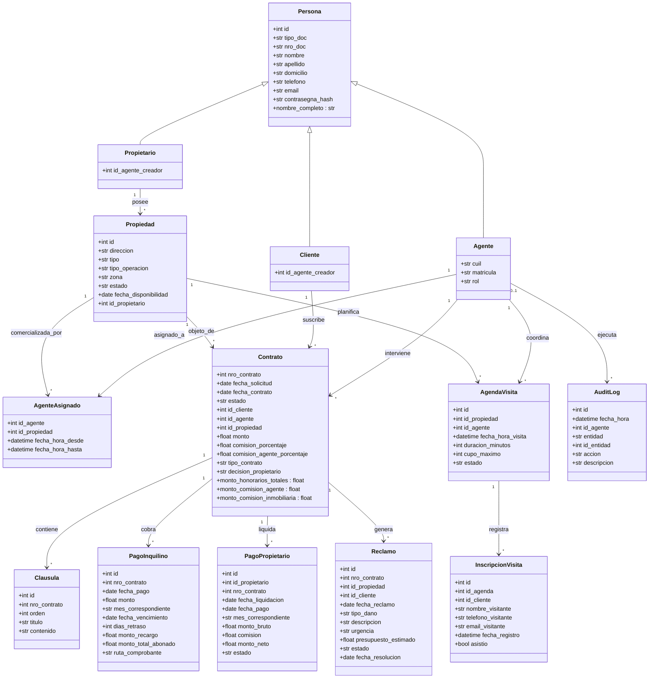

# 💾 4. Base de Datos y Modelo de Dominio

**InmoGestión B2B - Sistema Integral de Gestión Inmobiliaria**  
*Cátedra: Soporte a la Gestión con Tecnologías de la Información / Python*  
*Universidad Tecnológica Nacional - Facultad Regional Rosario (UTN FRRO)*

---

## 📐 Modelo de Dominio (Diagrama de Clases)

El modelo de dominio está diseñado según el paradigma orientado a objetos, estructurado en la capa de negocio ([`business/entities.py`](file:///business/entities.py)). La jerarquía central gira en torno a `Persona` y sus especializaciones:

---

## 🗄️ Esquema Relacional de Base de Datos (Tablas y Constraints)

A nivel físico, la persistencia se gestiona en [`datos/db.py`](file:///datos/db.py) a través de SQLAlchemy ORM, cumpliendo con la 3ra Forma Normal (3FN):

### 1. Tabla `persona` (Tabla Base Polimórfica)
| Columna | Tipo de Dato | Nulable | Restricciones / Descripción |
| :--- | :--- | :---: | :--- |
| `id` | `INTEGER` | NO | Clave Primaria (Autoincremental) |
| `tipo_doc` | `VARCHAR(50)` | NO | DNI, CUIT, Pasaporte, etc. |
| `nro_doc` | `VARCHAR(50)` | NO | Número de identificación |
| `nombre` | `VARCHAR(100)` | NO | Nombre de la persona |
| `apellido` | `VARCHAR(100)` | NO | Apellido de la persona |
| `domicilio` | `VARCHAR(200)` | NO | Domicilio real o legal |
| `telefono` | `VARCHAR(50)` | NO | Número de contacto telefónico |
| `email` | `VARCHAR(100)` | NO | Correo electrónico principal |
| `contrasegna_hash` | `VARCHAR(255)` | NO | Hash criptográfico (`pbkdf2:sha256`) |
| `tipo_persona` | `VARCHAR(50)` | NO | Columna discriminadora (`persona`, `agente`, `cliente`, `propietario`) |
- **Unique Constraints:**
  - `uq_persona_tipo_nro_doc`: `UNIQUE (tipo_persona, nro_doc)`
  - `uq_persona_tipo_email`: `UNIQUE (tipo_persona, email)`

### 2. Tabla `agente` (Especialización)
| Columna | Tipo de Dato | Nulable | Restricciones / Descripción |
| :--- | :--- | :---: | :--- |
| `id` | `INTEGER` | NO | Clave Primaria, Foreign Key (`persona.id`) |
| `cuil` | `VARCHAR(20)` | NO | Identificación fiscal única (`UNIQUE`) |
| `matricula` | `VARCHAR(50)` | NO | Matrícula profesional habilitante (`UNIQUE`) |
| `rol` | `VARCHAR(50)` | NO | `"Administrador"` o `"Estándar"` (Default: `"Estándar"`) |

### 3. Tablas `cliente` y `propietario` (Especializaciones)
| Columna | Tipo de Dato | Nulable | Restricciones / Descripción |
| :--- | :--- | :---: | :--- |
| `id` | `INTEGER` | NO | Clave Primaria, Foreign Key (`persona.id`) |
| `id_agente` | `INTEGER` | SÍ | Foreign Key (`agente.id`), Agente comercial responsable de la cartera |

### 4. Tabla `propiedad`
| Columna | Tipo de Dato | Nulable | Restricciones / Descripción |
| :--- | :--- | :---: | :--- |
| `id` | `INTEGER` | NO | Clave Primaria (Autoincremental) |
| `direccion` | `VARCHAR(200)` | NO | Calle, altura, piso, depto |
| `tipo` | `VARCHAR(50)` | NO | Tipo de inmueble: `Casa`, `Departamento`, `Local`, `Terreno`, `Oficina` |
| `tipo_operacion` | `VARCHAR(20)` | NO | Destino comercial: `Alquiler` o `Venta` |
| `zona` | `VARCHAR(100)` | NO | Barrio o sector geográfico |
| `estado` | `VARCHAR(50)` | NO | `disponible`, `alquilada`, `vendida` |
| `fecha_disponibilidad`| `DATE` | NO | Fecha de inicio de comercialización |
| `id_propietario` | `INTEGER` | NO | Foreign Key (`propietario.id`) |

### 5. Tabla `contrato`
| Columna | Tipo de Dato | Nulable | Restricciones / Descripción |
| :--- | :--- | :---: | :--- |
| `nro_contrato` | `INTEGER` | NO | Clave Primaria (Autoincremental) |
| `fecha_solicitud` | `DATE` | NO | Fecha de emisión de la solicitud |
| `estado` | `VARCHAR(50)` | NO | `solicitado`, `activo`, `finalizado`, `cancelado` |
| `fecha_contrato` | `DATE` | SÍ | Fecha formal de firma del contrato |
| `id_cliente` | `INTEGER` | NO | Foreign Key (`cliente.id`) |
| `id_agente` | `INTEGER` | NO | Foreign Key (`agente.id`) |
| `id_propiedad` | `INTEGER` | NO | Foreign Key (`propiedad.id`) |
| `monto` | `NUMERIC(12, 2)`| NO | Valor del canon mensual o precio de venta |
| `comision_porcentaje` | `NUMERIC(5, 2)` | NO | Porcentaje total de honorarios (ej: 10.0%) |
| `comision_agente_porcentaje` | `NUMERIC(5, 2)` | NO | Porcentaje asignado al agente comercial (ej: 3.0%) |
| `tipo_contrato` | `VARCHAR(50)` | NO | `Alquiler` o `Compraventa` |
| `decision_propietario`| `VARCHAR(20)` | NO | `pendiente`, `aprobado`, `rechazado` |
| `fecha_ultimo_aviso_mora` | `DATE` | SÍ | Control anti-spam para avisos de mora |

### 6. Tabla `clausula`
| Columna | Tipo de Dato | Nulable | Restricciones / Descripción |
| :--- | :--- | :---: | :--- |
| `id` | `INTEGER` | NO | Clave Primaria (Autoincremental) |
| `nro_contrato` | `INTEGER` | NO | Foreign Key (`contrato.nro_contrato`) |
| `orden` | `INTEGER` | NO | Orden correlativo dentro del contrato |
| `titulo` | `VARCHAR(200)` | NO | Nombre de la cláusula legal |
| `contenido` | `TEXT` | NO | Redacción legal completa |

### 7. Tabla `pago_inquilino`
| Columna | Tipo de Dato | Nulable | Restricciones / Descripción |
| :--- | :--- | :---: | :--- |
| `id` | `INTEGER` | NO | Clave Primaria (Autoincremental) |
| `nro_contrato` | `INTEGER` | NO | Foreign Key (`contrato.nro_contrato`) |
| `fecha_pago` | `DATE` | NO | Fecha real en la que el inquilino pagó |
| `monto` | `NUMERIC(12, 2)`| NO | Canon base del alquiler |
| `mes_correspondiente`| `VARCHAR(7)` | NO | Período en formato `YYYY-MM` |
| `fecha_vencimiento` | `DATE` | SÍ | Día 10 del período |
| `dias_retraso` | `INTEGER` | NO | Días transcurridos después del vencimiento |
| `monto_recargo` | `NUMERIC(12, 2)`| NO | Recargo acumulado por mora (0.2% diario) |
| `monto_total_abonado`| `NUMERIC(12, 2)`| SÍ | `monto + monto_recargo` |
| `ruta_comprobante` | `VARCHAR(500)`| SÍ | Ruta al archivo adjunto (PDF / Imagen) |

### 8. Tabla `pago_propietario` (Liquidación)
| Columna | Tipo de Dato | Nulable | Restricciones / Descripción |
| :--- | :--- | :---: | :--- |
| `id` | `INTEGER` | NO | Clave Primaria (Autoincremental) |
| `id_propietario` | `INTEGER` | NO | Foreign Key (`propietario.id`) |
| `nro_contrato` | `INTEGER` | NO | Foreign Key (`contrato.nro_contrato`) |
| `fecha_liquidacion` | `DATE` | NO | Fecha de cálculo de la liquidación |
| `fecha_pago` | `DATE` | SÍ | Fecha de transferencia bancaria efectiva |
| `mes_correspondiente`| `VARCHAR(7)` | NO | Período liquidado (`YYYY-MM`) |
| `monto_bruto` | `NUMERIC(12, 2)`| NO | Monto total percibido del inquilino |
| `comision` | `NUMERIC(12, 2)`| NO | Honorarios retenidos por la inmobiliaria |
| `monto_neto` | `NUMERIC(12, 2)`| NO | `monto_bruto - comision` |
| `estado` | `VARCHAR(20)` | NO | `pendiente` o `pagado` |

### 9. Tabla `reclamo`
| Columna | Tipo de Dato | Nulable | Restricciones / Descripción |
| :--- | :--- | :---: | :--- |
| `id` | `INTEGER` | NO | Clave Primaria (Autoincremental) |
| `nro_contrato` | `INTEGER` | NO | Foreign Key (`contrato.nro_contrato`) |
| `id_propiedad` | `INTEGER` | NO | Foreign Key (`propiedad.id`) |
| `id_cliente` | `INTEGER` | NO | Foreign Key (`cliente.id`) |
| `fecha_reclamo` | `DATE` | NO | Fecha de asentamiento del reclamo |
| `tipo_dano` | `VARCHAR(100)` | NO | Rubro (Plomería, Electricidad, Gas, etc.) |
| `descripcion` | `VARCHAR(1000)`| NO | Detalle descriptivo de la avería |
| `urgencia` | `VARCHAR(20)` | NO | `Baja`, `Media`, `Alta`, `Urgente` |
| `presupuesto_estimado`| `NUMERIC(12, 2)`| NO | Cotización estimada para la reparación |
| `estado` | `VARCHAR(30)` | NO | `pendiente`, `informado_propietario`, `en_reparacion`, `resuelto`, `desestimado` |
| `fecha_resolucion` | `DATE` | SÍ | Fecha en que el reclamo fue resuelto |

### 10. Tablas `agenda_visita` e `inscripcion_visita`
- `agenda_visita`: vincula `id_propiedad`, `id_agente`, `fecha_hora_visita`, `duracion_minutos`, `cupo_maximo` y `estado` (`disponible`, `completo`, `cancelada`).
- `inscripcion_visita`: vincula `id_agenda`, `id_cliente` (opcional), `nombre_visitante`, `telefono_visitante`, `email_visitante`, `fecha_registro` y `asistio`.

### 11. Tabla `logs_auditoria`
| Columna | Tipo de Dato | Nulable | Restricciones / Descripción |
| :--- | :--- | :---: | :--- |
| `id` | `INTEGER` | NO | Clave Primaria (Autoincremental) |
| `fecha_hora` | `DATETIME` | NO | Marca de tiempo exacta del evento |
| `id_agente` | `INTEGER` | SÍ | Foreign Key (`persona.id`), Agente que ejecutó la acción |
| `entidad` | `VARCHAR(50)` | NO | Entidad afectada (`contrato`, `pago`, `visita`, etc.) |
| `id_entidad` | `INTEGER` | SÍ | ID del registro afectado |
| `accion` | `VARCHAR(50)` | NO | `CREAR`, `FIRMAR`, `CANCELAR`, `PAGAR`, `RECHAZAR` |
| `descripcion` | `VARCHAR(500)` | NO | Texto detallado de la auditoría |

---

## ⚙️ Migración y Consistencia Automática (`init_db`)

En [`datos/db.py`](file:///datos/db.py), la función `init_db()` analiza dinámicamente mediante `sqlalchemy.inspect` la estructura de las tablas existentes:
1. **Comprobación de Columnas:** Si una base de datos antigua carece de nuevas columnas incorporadas (como `tipo_operacion` en `propiedad`, `id_agente_creador` en `cliente`/`propietario`, o campos de decisión del dueño en `contrato`), ejecuta automáticamente sentencias `ALTER TABLE` sin pérdida de información histórica.
2. **Migración de Datos Semánticos:** La función `_migrar_tipo_operacion_propiedad()` analiza la dirección y el historial contractual de cada propiedad para inferir correctamente su tipo de inmueble (Casa, Depto, Local) y su operación comercial (Alquiler o Venta), garantizando total retrocompatibilidad.

