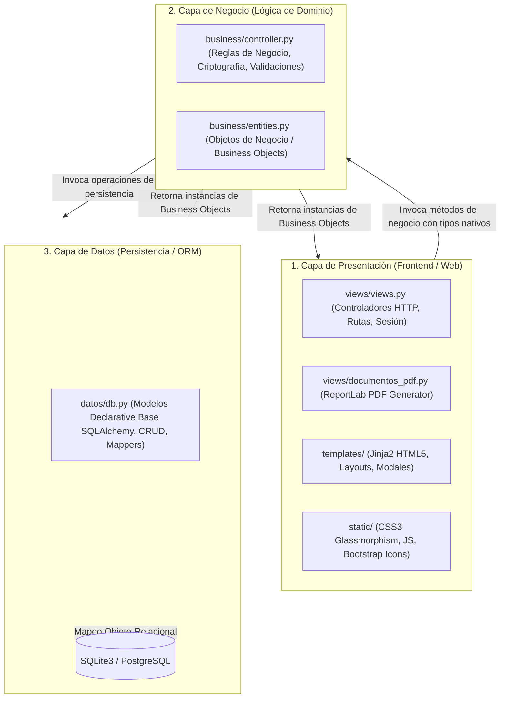
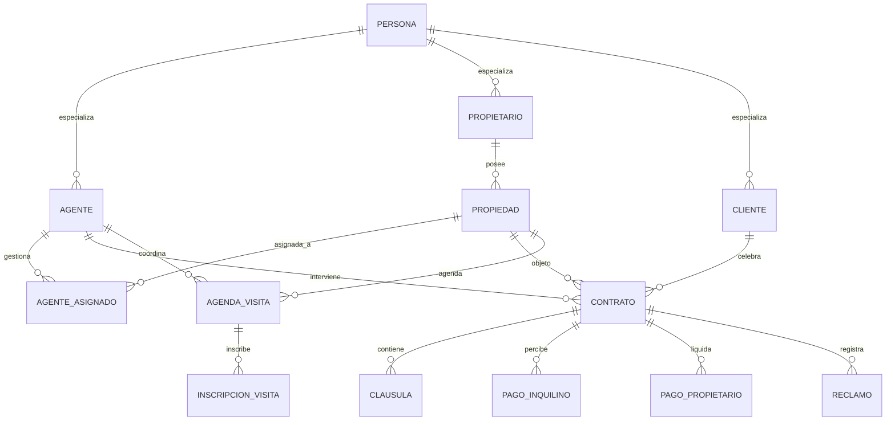
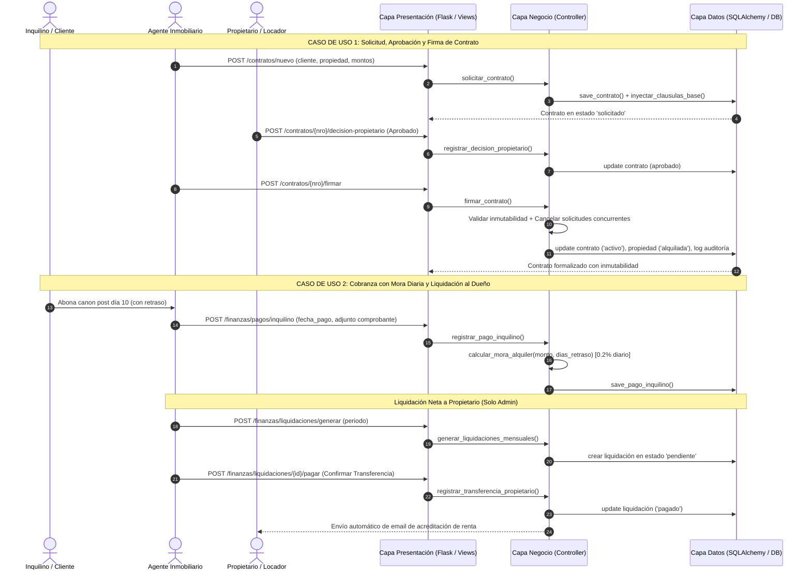

# 📘 Documentación Integral del Trabajo Práctico Integrador (TPI)
## **Sistema InmoGestión B2B - Gestión Inmobiliaria Integral en 3 Capas**

```text
========================================================================================
UNIVERSIDAD TECNOLÓGICA NACIONAL - FACULTAD REGIONAL ROSARIO
Carrera: Ingeniería en Sistemas de Información / Tecnicatura Universitaria en Programación
Cátedra: Soporte a la Gestión con Tecnologías de la Información / Programación en Python
Ciclo Lectivo: 2026
Proyecto: InmoGestión B2B - Sistema Web de Gestión Inmobiliaria
Patrón Arquitectónico: Arquitectura en 3 Capas Desacopladas
========================================================================================
```

---

## 📑 Índice General de la Documentación

1. [El Problema y la Justificación del Sistema](#1-el-problema-y-la-justificación-del-sistema)
2. [Arquitectura en 3 Capas Desacopladas](#2-arquitectura-en-3-capas-desacopladas)
3. [Tecnologías y Stack Técnico](#3-tecnologías-y-stack-técnico)
4. [Base de Datos y Modelo de Dominio](#4-base-de-datos-y-modelo-de-dominio)
5. [Catálogo Completo de Funcionalidades y Módulos](#5-catálogo-completo-de-funcionalidades-y-módulos)
6. [Matriz de Reglas de Negocio Implementadas](#6-matriz-de-reglas-de-negocio-implementadas)
7. [Guía de Puesta en Marcha y Despliegue](#7-guía-de-puesta-en-marcha-y-despliegue)
8. [Casos de Uso Principales y Catálogo de Endpoints](#8-casos-de-uso-principales-y-catálogo-de-endpoints)
9. [Cumplimiento de Checklists Académicos UTN](#9-cumplimiento-de-checklists-académicos-utn)

---

## 1. El Problema y la Justificación del Sistema

### Contexto y Problemática del Negocio Inmobiliario Tradicional
La gestión operativa, comercial y financiera de una inmobiliaria involucra una multiplicidad de actores interrelacionados: locadores (propietarios), locatarios y compradores (clientes), martilleros y corredores comerciales (agentes), y el equipo directivo.

En agencias tradicionales, la ausencia de un sistema informático centralizado y robusto genera graves obstáculos:
1. **Desorganización de Visitas y Superposiciones:** La falta de control en agendas produce solapamientos horarios para los corredores y sobrecupo de personas en los inmuebles durante las exhibiciones.
2. **Inmuebles Estancados y Falta de Diagnóstico de Vacancia:** Dificultad para cuantificar objetivamente cuántos días lleva un inmueble vacante en el mercado, imposibilitando negociar bajas de precio informadas con los propietarios.
3. **Inseguridad Jurídica y Alteración Contractual:** Redacción informal de contratos con omisión de cláusulas esenciales y riesgo de modificación posterior de acuerdos una vez suscriptos.
4. **Descontrol Financiero y Mora Inexacta:** Cobro de alquileres sin un cálculo estandarizado de mora diaria posterior al vencimiento (día 10), pérdida de comprobantes de pago y emisión deficiente de recibos.
5. **Retrasos en Liquidaciones y Transferencias a Propietarios:** Dificultades para calcular masivamente la comisión retenida por la agencia y el saldo neto a transferir, con riesgo de liquidar fondos antes de que el inquilino haya cancelado su deuda.
6. **Reclamos de Mantenimiento Desordenados:** Averías edilicias canalizadas informalmente, sin registro del contrato, sin nivel de urgencia ni presupuestos formales para someter a aprobación del propietario.
7. **Ausencia de Aislamiento de Carteras Comerciales:** Fricciones internas entre corredores por falta de privacidad en sus clientes y propietarios asignados.

### Solución: InmoGestión B2B
**InmoGestión B2B** resuelve de manera integral estos desafíos digitalizando el ciclo completo de la inmobiliaria:
- Captación y publicación de propiedades con asignación de corredores.
- Análisis estratégico de vacancia e inactividad comercial con semaforización y planes automáticos de acción.
- Agendas de visitas con cupos estrictos y validación de no superposición horaria.
- Generación asistida de contratos con autoinyección de cláusulas legales y garantía de **inmutabilidad** tras la firma.
- Circuito de evaluación crediticia y decisión formal del propietario (aprobado/rechazado).
- Gestión integral de averías con emisión de presupuestos técnicos vectorizados en PDF (ReportLab).
- Registro contable de cobros con cálculo automático de mora diaria al 0.2%, subida de comprobantes y emisión de boletas con código de barras `Code128`.
- Liquidaciones masivas netas a propietarios condicionadas al cobro efectivo previo y confirmación de transferencias con avisos por correo.
- Logs de auditoría inmutables y exportación contable en CSV.

---

## 2. Arquitectura en 3 Capas Desacopladas

El sistema implementa estrictamente una **Arquitectura en 3 Capas** con flujo de dependencias unidireccional:



### Principios Arquitectónicos Aplicados:
- **Aislamiento Total entre Presentación y Datos:** La capa de presentación (`views/views.py`) **nunca** importa `datos/db.py`, ni interactúa con modelos ORM ni ejecuta consultas SQL. Toda interacción pasa exclusivamente por `business/controller.py`.
- **Independencia de Interfaz en Negocio:** `business/controller.py` no importa librerías HTTP ni genera código HTML. Maneja la lógica de dominio y retorna **Objetos de Negocio (BO)** definidos en `business/entities.py`.
- **Agnosticismo del Motor de Base de Datos:** La capa de datos permite conmutar entre **SQLite3** local y **PostgreSQL** mediante variables de entorno (`DATABASE_URL`), sin que la lógica de negocio ni las vistas requieran modificación alguna.
- **Mapeo a Entidades BO:** Toda consulta en `datos/db.py` transforma los registros físicos en objetos de negocio (`to_bo_cliente`, `to_bo_propiedad`, `to_bo_contrato`, etc.) antes de devolverlos.

---

## 3. Tecnologías y Stack Técnico

| Área | Tecnología | Versión | Justificación |
| :--- | :--- | :--- | :--- |
| **Lenguaje Core** | **Python** | 3.10+ | Lenguaje multiplataforma estándar de la cátedra con soporte para orientación a objetos pura, decoradores y tipado opcional. |
| **Framework Web** | **Flask** | 3.1.x | Microframework web desacoplado y liviano con Blueprints modulares, facilitando el cumplimiento de la arquitectura en capas. |
| **Motor de Plantillas** | **Jinja2** | 3.1.x | Herencia de plantillas (`layout.html`), macros reutilizables y protección automática contra inyecciones XSS. |
| **ORM de Persistencia** | **SQLAlchemy** | 2.0.x | ORM declarativo con mapeo polimórfico de herencia (`polymorphic_on`), transaccionalidad segura y prevención de inyecciones SQL. |
| **Base de Datos Local** | **SQLite3** | Embebida | Base relacional local "cero configuración" contenida en `tpi_inmobiliaria.db` para portabilidad inmediata en la corrección. |
| **Base de Datos Externa** | **PostgreSQL** | 14+ | Soporte de producción para alta concurrencia multiusuario mediante driver `psycopg2`. |
| **Seguridad Criptográfica** | **Werkzeug Security**| 3.1.x | Algoritmo criptográfico `pbkdf2:sha256` con salt dinámico para hashing irreversible de claves. |
| **Generación de PDFs** | **ReportLab** | 5.1.x | Maquetado vectorial de boletas de alquiler con código de barras `Code128` y presupuestos de reparación descargables en PDF. |
| **Configuración** | **python-dotenv** | 1.2.x | Desacoplamiento de credenciales y variables de entorno mediante archivo `.env`. |
| **Testing Automatizado** | **Pytest** | 9.x | Suite de tests unitarios y de integración para validar reglas de negocio, integridad financiera y flujos web. |
| **Calidad de Código** | **Flake8** | 7.x | Linter estático que valida el cumplimiento estricto del estándar de estilo **PEP 8**. |

---

## 4. Base de Datos y Modelo de Dominio

### Jerarquía Polimórfica de Entidades
La clase base abstracta `Persona` centraliza atributos comunes (documento, nombre, apellido, domicilio, teléfono, email y contraseña cifrada). A través de SQLAlchemy se implementa herencia con tabla única (`persona`) y tablas especializadas vinculadas por clave foránea:
- **`Agente`:** agrega `cuil`, `matricula` y `rol` (`"Administrador"` o `"Estándar"`).
- **`Cliente`:** locatario o adquirente con referencia a su agente creador (`id_agente`).
- **`Propietario`:** titular de inmuebles y perceptor de liquidaciones (`id_agente`).



### Esquema Físico de Tablas Principales:
- `persona` (`id`, `tipo_doc`, `nro_doc`, `nombre`, `apellido`, `domicilio`, `telefono`, `email`, `contrasegna_hash`, `tipo_persona`).
- `agente` (`id` PK/FK, `cuil` UNIQUE, `matricula` UNIQUE, `rol`).
- `cliente` (`id` PK/FK, `id_agente` FK).
- `propietario` (`id` PK/FK, `id_agente` FK).
- `propiedad` (`id`, `direccion`, `tipo`, `tipo_operacion`, `zona`, `estado`, `fecha_disponibilidad`, `id_propietario` FK).
- `contrato` (`nro_contrato`, `fecha_solicitud`, `estado`, `fecha_contrato`, `id_cliente` FK, `id_agente` FK, `id_propiedad` FK, `monto`, `comision_porcentaje`, `comision_agente_porcentaje`, `tipo_contrato`, `decision_propietario`, `fecha_ultimo_aviso_mora`).
- `clausula` (`id`, `nro_contrato` FK, `orden`, `titulo`, `contenido`).
- `pago_inquilino` (`id`, `nro_contrato` FK, `fecha_pago`, `monto`, `mes_correspondiente`, `fecha_vencimiento`, `dias_retraso`, `monto_recargo`, `monto_total_abonado`, `ruta_comprobante`).
- `pago_propietario` (`id`, `id_propietario` FK, `nro_contrato` FK, `fecha_liquidacion`, `fecha_pago`, `mes_correspondiente`, `monto_bruto`, `comision`, `monto_neto`, `estado`).
- `reclamo` (`id`, `nro_contrato` FK, `id_propiedad` FK, `id_cliente` FK, `fecha_reclamo`, `tipo_dano`, `descripcion`, `urgencia`, `presupuesto_estimado`, `estado`, `fecha_resolucion`).
- `agenda_visita` (`id`, `id_propiedad` FK, `id_agente` FK, `fecha_hora_visita`, `duracion_minutos`, `cupo_maximo`, `estado`).
- `inscripcion_visita` (`id`, `id_agenda` FK, `id_cliente` FK, `nombre_visitante`, `telefono_visitante`, `email_visitante`, `fecha_registro`, `asistio`).
- `logs_auditoria` (`id`, `fecha_hora`, `id_agente` FK, `entidad`, `id_entidad`, `accion`, `descripcion`).

---

## 5. Catálogo Completo de Funcionalidades y Módulos

### 1. Autenticación y Control de Roles (RBAC)
- Login seguro con validación de hash irreversible (`pbkdf2:sha256`).
- Protección de endpoints con decoradores `@login_required` y `@admin_required`.
- Páginas estilizadas para errores `403 Forbidden` y `404 Not Found`.

### 2. Dashboard Ejecutivo con KPIs en Tiempo Real
- Contadores dinámicos de propiedades por estado (*Disponibles, Alquiladas, Vendidas*).
- Cartera de clientes y contratos vigentes.
- Métricas financieras del período: recaudación cobrada vs. pendiente, porcentaje de eficiencia de cobro y alertas de morosidad.

### 3. Catálogo de Propiedades y Asignación Comercial
- Catálogo con filtros cruzados por estado, tipo de inmueble, tipo de operación y zona.
- Ficha técnica completa de la propiedad con historial de agentes y contratos.
- Asignación flexible de agentes comerciales (un agente puede administrar múltiples propiedades simultáneamente).

### 4. Análisis Estratégico de Inactividad y Vacancia
- Mide los días exactos transcurridos desde la fecha de disponibilidad:
  $$\text{Días en Oferta} = \text{Fecha Actual} - \text{Fecha de Disponibilidad}$$
- **Semaforización comercial:**
  - 🟢 **Bajo ($\le 30$ días):** Comercialización saludable. Plan: mantener precio.
  - 🟡 **Moderado ($31 - 60$ días):** Interés moderado. Plan: reforzar publicidad y evaluar baja del 5%.
  - 🟠 **Alto ($61 - 90$ días):** Inactividad prolongada. Plan: reunión con dueño para reducir valor un 10%.
  - 🔴 **Crítico ($> 90$ días):** Propiedad estancada. Plan: reducción obligada del 15% o replanteo de destino.

### 5. Agenda de Visitas con Control Estricto de Cupos
- Programación de turnos con duración y cupo máximo de personas.
- **Validación de no superposición:** rechaza visitas que se solapen en la agenda del mismo agente.
- **Control de aforo restrictivo:** al alcanzar el cupo máximo el turno cambia a `completo` e impide inscripciones adicionales.

### 6. Aislamiento de Cartera por Agente
- Los agentes comerciales estándar solo visualizan y operan con los clientes y propietarios que ellos mismos registraron.
- Los administradores conservan acceso y supervisión global sobre toda la cartera.

### 7. Contratos Legales, Cláusulas e Inmutabilidad
- Solicitud de contratos con autoinyección de cláusulas base (6 cláusulas para locación y 5 para compraventa).
- Carga de garantías y recibos de sueldo con soporte de adjuntos digitales.
- Editor de cláusulas y comisiones habilitado únicamente en estado borrador (`solicitado`).
- **Inmutabilidad absoluta tras la firma:** al pasar a `activo`, queda terminantemente prohibido modificar o suprimir cláusulas o comisiones.
- Plantilla de impresión legal formal lista para firmas.

### 8. Decisión del Propietario y Cancelación Concurrente
- Circuito de evaluación donde el propietario registra su decisión (`aprobado`, `rechazado`, `pendiente`).
- **Cancelación concurrente:** cuando se firma una solicitud sobre una propiedad, cualquier otra solicitud pendiente en borrador sobre ese inmueble pasa automáticamente a `cancelado` con asiento en auditoría.

### 9. Módulo de Reclamos y Presupuestos PDF para Propietarios
- Registro de averías edilicias vinculadas al contrato activo (Plomería, Electricidad, Gas, etc.).
- Ciclo de vida: `Pendiente` ➔ `Informado al Propietario` ➔ `En Reparación` ➔ `Resuelto` / `Desestimado`.
- Emisión de presupuestos formales vectorizados en PDF con ReportLab listos para enviar al dueño para su conformidad.

### 10. Finanzas, Mora Diaria al 0.2% y Boletas PDF
- Registro de cobro de alquileres con soporte para comprobantes adjuntos (PDF/JPG/PNG).
- **Vencimiento base al día 10:** los pagos posteriores calculan automáticamente los días exactos de atraso y un recargo diario del 0.2%:
  $$\text{Recargo} = \text{Canon Base} \times 0.002 \times \text{Días de Atraso}$$
- **Boleta mensual en PDF:** emisión de comprobante con código de barras `Code128`, desglose de vencimientos y datos bancarios de la inmobiliaria.
- Prevención de duplicidad: rechaza registrar dos pagos para el mismo contrato y período.

### 11. Liquidaciones a Propietarios y Transferencias
- Generación masiva mensual de liquidaciones calculando automáticamente la comisión de la inmobiliaria y el saldo neto.
- Condición estricta: requiere cobro previo del inquilino.
- Confirmación de transferencia bancaria y notificación automática por email al propietario.
- Exportación contable de cobros y liquidaciones en CSV para Excel.

### 12. Traspaso de Titularidad tras Compraventa
- Al volver a administrar una propiedad vendida, permite traspasar la titularidad al adquirente (creándolo como Propietario si no lo era), archivando el contrato previo y liberando el inmueble como disponible.

### 13. Logs de Auditoría Inmutable
- Panel de control exclusivo para Administradores que registra cronológicamente cada acción sensible (creación, firma, cancelación, pago, rechazo), con fecha/hora, agente interviniente y detalle del evento.

---

## 6. Matriz de Reglas de Negocio Implementadas

| # | Regla de Negocio | Capa que la Valida | Comportamiento / Restricción Operativa |
| :-: | :--- | :---: | :--- |
| **RN-01** | **Disponibilidad para Contratos** | `business/controller.py` | Solo se puede solicitar o firmar un contrato sobre propiedades en estado `disponible`. |
| **RN-02** | **Asignación Agente-Contrato** | `business/controller.py` | El agente que suscribe el contrato debe ser el comercial formalmente asignado a la propiedad. |
| **RN-03** | **Multi-propiedad por Agente** | `business/controller.py` | Un agente comercial puede administrar simultáneamente múltiples propiedades sin límites. |
| **RN-04** | **Inmutabilidad Contractual** | `business/controller.py` | Prohibido editar o borrar cláusulas o modificar honorarios en contratos en estado `activo`. |
| **RN-05** | **Control Estricto de Cupos** | `business/controller.py` | Bloqueo automático de inscripciones cuando el cupo alcanza el máximo del turno. |
| **RN-06** | **No Superposición de Visitas** | `business/controller.py` | Se rechaza la creación de visitas que solapen horarios de otra visita ya agendada para el agente. |
| **RN-07** | **Visitas solo en Disponibles** | `business/controller.py` | Solo se pueden agendar visitas en inmuebles con estado `disponible`. |
| **RN-08** | **Reclamos en Contratos Activos** | `business/controller.py` | No se admiten reclamos sobre contratos en borrador, finalizados o cancelados. |
| **RN-09** | **Cálculo de Mora Diaria (0.2%)**| `business/controller.py` | Aplicación automática de tasa de mora del 0.2% por jornada sobre cánones abonados post día 10. |
| **RN-10** | **Unicidad de Pago Mensual** | `business/controller.py` | Impide duplicar el cobro de alquiler para un mismo contrato y mismo período (`YYYY-MM`). |
| **RN-11** | **Liquidación Previa al Pago** | `business/controller.py` | No se puede liquidar a un dueño si el inquilino no ha cancelado previamente su período. |
| **RN-12** | **Control de Acceso y Roles (RBAC)**| `views/views.py` & `controller` | Las acciones financieras de egreso, gestión de agentes y auditoría exigen rol `Administrador`. |
| **RN-13** | **Cifrado Criptográfico Obligatorio**| `business/controller.py` | Las contraseñas de todos los agentes se almacenan hasheadas con `pbkdf2:sha256`. |
| **RN-14** | **Unicidad de Identificadores en DB**| `datos/db.py` | Email, DNI/Documento, CUIL y Matrícula Profesional deben ser únicos e irrepetibles en la base. |
| **RN-15** | **Control Anti-Spam en Alertas** | `business/controller.py` | Evita reenviar alertas de mora duplicadas a un inquilino en la misma jornada. |
| **RN-16** | **Aislamiento de Cartera Comercial**| `business/controller.py` | Cada agente comercial estándar solo visualiza y opera sus propios clientes y propietarios. |
| **RN-17** | **Cancelación Concurrente** | `business/controller.py` | Al firmar un contrato, las demás solicitudes en borrador sobre ese inmueble pasan a `cancelado`. |
| **RN-18** | **Traspaso de Titularidad tras Venta**| `business/controller.py` | Permite transferir el inmueble al comprador tras la venta, reactivando la propiedad como disponible. |

---

## 7. Guía de Puesta en Marcha y Despliegue

### 1. Clonación y Acceso al Directorio
```bash
cd frro-python-2026-13/TPI
```

### 2. Entorno Virtual e Instalación de Dependencias
```bash
# Crear entorno virtual
python -m venv .venv

# Activar en Windows PowerShell:
.\.venv\Scripts\Activate.ps1
# (En Linux / macOS: source .venv/bin/activate)

# Instalar dependencias
pip install -r requirements.txt
```

### 3. Configuración de Variables de Entorno (`.env`)
Copiar el archivo de plantilla:
```bash
# Windows PowerShell:
Copy-Item .env.example .env
# Linux / macOS:
cp .env.example .env
```
*(Por defecto, si no se configura `DATABASE_URL`, el sistema utiliza la base de datos local SQLite `tpi_inmobiliaria.db` sin configuraciones adicionales).*

### 4. Ejecución del Servidor
```bash
python app.py
```
Acceder mediante navegador web a:  
👉 **[http://127.0.0.1:5000](http://127.0.0.1:5000)**

### 5. Credenciales de Acceso Precargadas

| Rol | Correo Electrónico | Contraseña |
| :--- | :--- | :--- |
| **Administrador (Acceso Total)** | `admin@inmogestion.com` | `adminpassword` |
| **Administrador** | `valeria.torres@inmogestion.com` | `pass123` |
| **Agente Comercial Estándar** | `martin.gomez@inmogestion.com` | `pass123` |
| **Agente Comercial Estándar** | `lucas.benitez@inmogestion.com` | `pass123` |
| **Agente Comercial Estándar** | `carolina.diaz@inmogestion.com` | `pass123` |

### 6. Ejecución de Tests Automatizados y Linter
```bash
# Ejecutar todas las pruebas con reporte detallado
pytest -v

# Validar estándares de estilo PEP 8
flake8 .
```

---

## 8. Casos de Uso Principales y Catálogo de Endpoints



---

## 9. Cumplimiento de Checklists Académicos UTN

### Síntesis de Validación
- **Arquitectura en 3 Capas (`checklist_capas.md`):** 100% de cumplimiento. La capa de presentación no toca la base ni modelos ORM; la capa de negocio no toca HTTP ni HTML y solo retorna objetos de dominio; la capa de datos concentra todas las consultas y usa SQLAlchemy ORM; el punto de arranque está en la raíz (`app.py`).
- **Buenas Prácticas de Programación (`checklist_general.md`):** 100% de cumplimiento. Nomenclatura PEP 8 (`PascalCase` y `snake_case`), ausencia total de variables globales mutables, contraseñas protegidas criptográficamente con hash, manejo de errores HTTP 403 y 404, soporte multiusuario con sesiones independientes, diseño responsive adaptable y suite de pruebas unitarias automatizadas con Pytest.

