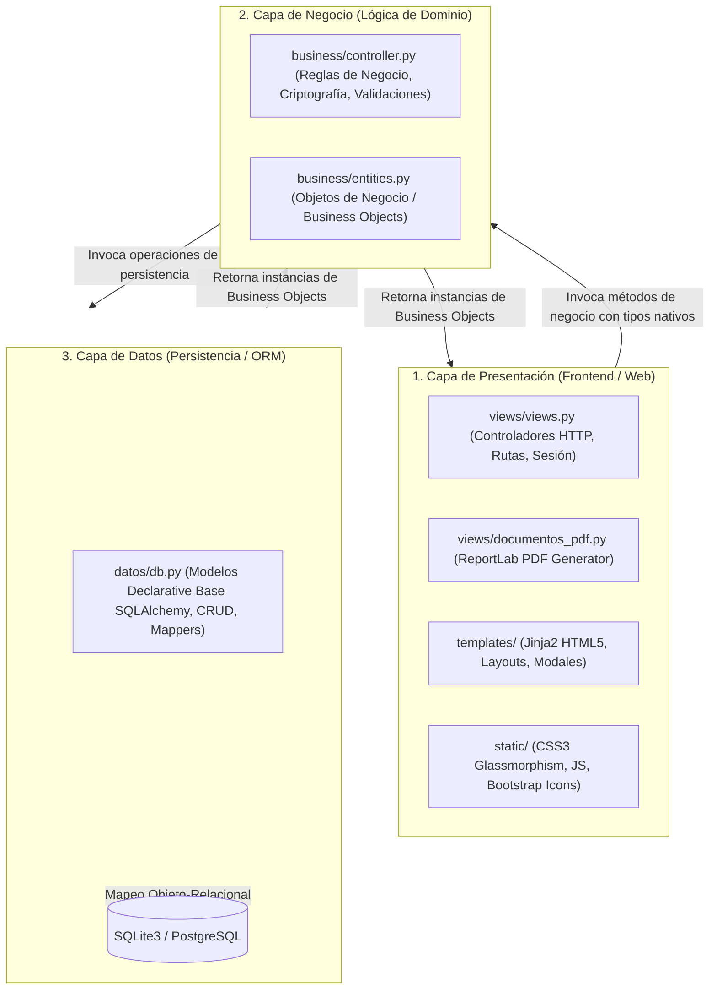
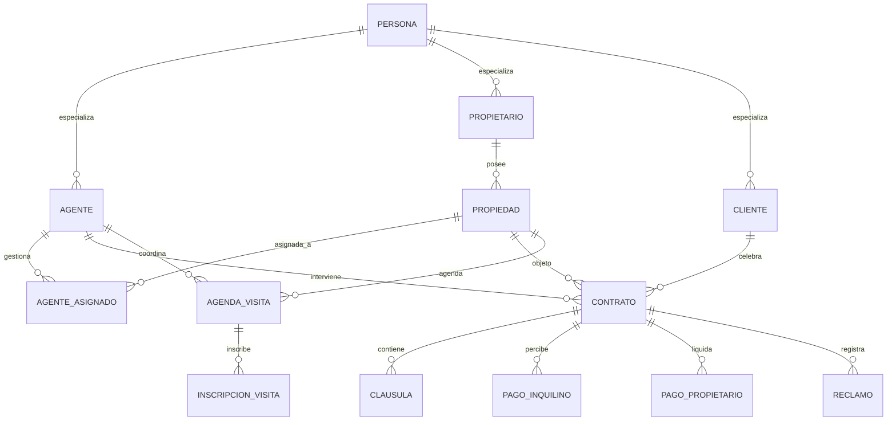
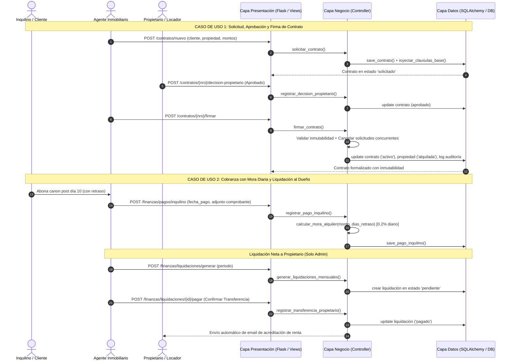

# InmoGestión B2B

Trabajo Práctico Integrador – Sistema de gestión inmobiliaria

Universidad Tecnológica Nacional, Facultad Regional Rosario  
Materia: Soporte a la Gestión de Datos con Programación Visual
Ciclo lectivo 2026

**Integrantes**

- Zabaleta, Gianlucas (gianzabaleta05@gmail.com)
- Peppino, Valentin (peppinovalentin@gmail.com)
- Maggi, Lucas (lucasmaggi03@gmail.com)

## 📑 Índice General de la Documentación

1. [El Problema y la Justificación del Sistema](#1-el-problema-y-la-justificación-del-sistema)
2. [Arquitectura en 3 Capas Desacopladas](#2-arquitectura-en-3-capas-desacopladas)
3. [Tecnologías y Stack Técnico](#3-tecnologías-y-stack-técnico)
4. [Base de Datos y Modelo de Dominio](#4-base-de-datos-y-modelo-de-dominio)
5. [Catálogo Completo de Funcionalidades y Módulos](#5-catálogo-completo-de-funcionalidades-y-módulos)
6. [Matriz de Reglas de Negocio Implementadas](#6-matriz-de-reglas-de-negocio-implementadas)
7. [Guía de Puesta en Marcha y Despliegue](#7-guía-de-puesta-en-marcha-y-despliegue)
8. [Casos de Uso Principales y Catálogo de Endpoints](#8-casos-de-uso-principales-y-catálogo-de-endpoints)

---

## 1. El problema y la justificación del sistema

### Contexto

Una inmobiliaria coordina a varias personas: los propietarios que ceden sus inmuebles, los clientes que alquilan o compran, los agentes que los atienden y la administración que cobra y liquida. Cuando todo esto se maneja con planillas y mensajes sueltos, aparecen errores que cuestan tiempo y dinero.

### Problemas que detectamos

- Las visitas se superponen y no se controla cuánta gente entra a un inmueble.
- No se sabe cuánto tiempo lleva una propiedad sin alquilarse, y eso dificulta pedirle al dueño una baja de precio.
- Los contratos se pueden modificar después de firmados.
- La mora se calcula a mano, los comprobantes se pierden y los recibos son informales.
- Es fácil liquidarle al propietario antes de que el inquilino haya pagado.
- Los reclamos de mantenimiento no quedan asociados a un contrato ni tienen presupuesto formal.
- Un agente puede ver los clientes de otro.

### Cómo los resuelve InmoGestión

| Problema | Qué hace el sistema |
| :--- | :--- |
| Visitas superpuestas y sin límite | Cada turno tiene cupo máximo; al llenarse se bloquea. Un agente no puede tener dos visitas a la misma hora. |
| Propiedades estancadas | Calcula los días desde la fecha de disponibilidad y los clasifica en cuatro niveles con una sugerencia de acción. |
| Contratos modificados | Las cláusulas se cargan solas al crear el contrato y se pueden editar hasta la firma. Después ya no se puede cambiar nada. |
| Mora y recibos | Calcula la mora automáticamente (0,2% por día desde el día 11), guarda el comprobante y emite la boleta en PDF. |
| Liquidaciones anticipadas | Solo se liquida lo que el inquilino ya pagó, y el Administrador confirma la transferencia. |
| Reclamos desordenados | Cada reclamo se asocia a un contrato activo, con urgencia, presupuesto y un PDF para el propietario. |
| Falta de privacidad entre agentes | Cada agente ve solo sus clientes y propietarios; el Administrador ve todo. |

Además, el sistema registra en una auditoría las acciones sensibles (firmas, pagos, cancelaciones) y permite exportar los cobros y las liquidaciones a CSV.

---

## 2. Arquitectura en 3 Capas Desacopladas

El sistema implementa estrictamente una **Arquitectura en 3 Capas** con flujo de dependencias unidireccional:



### Principios Arquitectónicos Aplicados:
- **Aislamiento Total entre Presentación y Datos:** La capa de presentación (`views/views.py`) **nunca** importa `datos/db.py`, ni interactúa con modelos ORM ni ejecuta consultas SQL. Toda interacción pasa exclusivamente por `business/controller.py`.
- **Independencia de Interfaz en Negocio:** `business/controller.py` no importa librerías HTTP ni genera código HTML. Maneja la lógica de dominio y retorna **Objetos de Negocio (BO)** definidos en `business/entities.py`.
- **Agnosticismo del Motor de Base de Datos:** La capa de datos permite conmutar entre **SQLite3** local y **PostgreSQL** mediante variables de entorno (`DATABASE_URL`), sin que la lógica de negocio ni las vistas requieran modificación alguna.
- **Mapeo a Entidades BO:** Toda consulta en `datos/db.py` transforma los registros físicos en objetos de negocio (`to_bo_cliente`, `to_bo_propiedad`, `to_bo_contrato`, etc.) antes de devolverlos.

---

## 3. Tecnologías y Stack Técnico

| Capa | Tecnología | Versión | Uso en el proyecto |
| :--- | :--- | :--- | :--- |
| Lenguaje | Python | 3.10 o superior | Todo el backend, los tests y los scripts de carga de datos |
| Servidor web | Flask | 3.x | Rutas, sesión, formularios, manejo de errores |
| Plantillas | Jinja2 | 3.x | Páginas HTML con herencia (`layout.html`) |
| Acceso a datos | SQLAlchemy | 2.x | Modelos, consultas y migración de la base |
| Base de datos | SQLite / PostgreSQL | – | SQLite por defecto; PostgreSQL con `DATABASE_URL` |
| Seguridad | Werkzeug | 3.x | Hash de contraseñas y nombres de archivo seguros |
| Configuración | python-dotenv | 1.x | Lectura del archivo `.env` |
| PDF | ReportLab | 4.x | Boleta de cobro y presupuesto de reclamos |
| Correo | `smtplib` y `email` | Biblioteca estándar | Alertas de mora y aviso de transferencia |
| Interfaz | HTML, CSS propio, JavaScript | – | Pantallas, tablas y filtros |
| Librerías web | DataTables, jQuery, Select2, Bootstrap Icons | DataTables 1.13.6, Icons 1.11.3 | Tablas con búsqueda, selectores y íconos |
| Tests | pytest | 8 o superior | 56 tests automáticos |
| Estilo | flake8 | 7.x | Revisión del código según PEP 8 |

---

## 4. Base de Datos y Modelo de Dominio

### Jerarquía Polimórfica de Entidades
La clase base abstracta `Persona` centraliza atributos comunes (documento, nombre, apellido, domicilio, teléfono, email y contraseña cifrada). A través de SQLAlchemy se implementa herencia con tabla única (`persona`) y tablas especializadas vinculadas por clave foránea:
- **`Agente`:** agrega `cuil`, `matricula` y `rol` (`"Administrador"` o `"Estándar"`).
- **`Cliente`:** locatario o adquirente con referencia a su agente creador (`id_agente`).
- **`Propietario`:** titular de inmuebles y perceptor de liquidaciones (`id_agente`).



### Esquema Físico de Tablas Principales:
- `persona` (`id`, `tipo_doc`, `nro_doc`, `nombre`, `apellido`, `domicilio`, `telefono`, `email`, `contrasegna_hash`, `tipo_persona`).
- `agente` (`id` PK/FK, `cuil` UNIQUE, `matricula` UNIQUE, `rol`).
- `cliente` (`id` PK/FK, `id_agente` FK).
- `propietario` (`id` PK/FK, `id_agente` FK).
- `propiedad` (`id`, `direccion`, `tipo`, `tipo_operacion`, `zona`, `estado`, `fecha_disponibilidad`, `id_propietario` FK).
- `contrato` (`nro_contrato`, `fecha_solicitud`, `estado`, `fecha_contrato`, `id_cliente` FK, `id_agente` FK, `id_propiedad` FK, `monto`, `comision_porcentaje`, `comision_agente_porcentaje`, `tipo_contrato`, `decision_propietario`, `fecha_ultimo_aviso_mora`).
- `clausula` (`id`, `nro_contrato` FK, `orden`, `titulo`, `contenido`).
- `pago_inquilino` (`id`, `nro_contrato` FK, `fecha_pago`, `monto`, `mes_correspondiente`, `fecha_vencimiento`, `dias_retraso`, `monto_recargo`, `monto_total_abonado`, `ruta_comprobante`).
- `pago_propietario` (`id`, `id_propietario` FK, `nro_contrato` FK, `fecha_liquidacion`, `fecha_pago`, `mes_correspondiente`, `monto_bruto`, `comision`, `monto_neto`, `estado`).
- `reclamo` (`id`, `nro_contrato` FK, `id_propiedad` FK, `id_cliente` FK, `fecha_reclamo`, `tipo_dano`, `descripcion`, `urgencia`, `presupuesto_estimado`, `estado`, `fecha_resolucion`).
- `agenda_visita` (`id`, `id_propiedad` FK, `id_agente` FK, `fecha_hora_visita`, `duracion_minutos`, `cupo_maximo`, `estado`).
- `inscripcion_visita` (`id`, `id_agenda` FK, `id_cliente` FK, `nombre_visitante`, `telefono_visitante`, `email_visitante`, `fecha_registro`, `asistio`).
- `logs_auditoria` (`id`, `fecha_hora`, `id_agente` FK, `entidad`, `id_entidad`, `accion`, `descripcion`).

---

## 5. Catálogo Completo de Funcionalidades y Módulos

**Usuarios y roles.** Hay dos roles: Administrador y Agente. El Agente trabaja con sus propias propiedades, clientes y contratos. El Administrador ve todo y es el único que liquida, exporta, gestiona agentes y consulta la auditoría. Las rutas se protegen con los decoradores `login_required` y `admin_required`, y los permisos críticos se vuelven a validar en el controlador.

**Panel principal.** Muestra propiedades por estado, clientes y propietarios, contratos vigentes y la recaudación del mes (cobrado, pendiente y porcentaje).

**Propiedades.** Catálogo con filtros por estado, tipo, zona y propietario. Cada ficha muestra el historial de agentes asignados y de contratos. Al reasignar una propiedad se cierra la asignación anterior.

**Vacancia.** Calcula los días transcurridos desde la fecha de disponibilidad y los clasifica: hasta 30 días (bajo), 31 a 60 (moderado), 61 a 90 (alto) y más de 90 (crítico), con una sugerencia de acción para cada nivel (por ejemplo, bajar el precio 5%, 10% o 15%).

**Visitas.** Cada turno tiene duración y cupo máximo. Al llenarse queda en `completo` y no admite más inscripciones. Un agente no puede tener dos visitas en el mismo horario. La agenda general está en `/visitas`.

**Contratos.** Al solicitarlos se cargan cláusulas base (6 para alquiler y 5 para compraventa) que se pueden editar mientras el contrato no esté firmado. También se pueden adjuntar garantías y recibos de sueldo. El propietario aprueba o rechaza la oferta. Al firmar, el contrato pasa a `activo`, la propiedad a `alquilada` o `vendida`, y no se puede modificar nada más. Las otras solicitudes pendientes sobre ese inmueble se cancelan solas. Un alquiler activo se cierra con "Finalizar" y el inmueble vuelve a quedar disponible. Hay una vista de impresión para firmar en papel.

**Reclamos.** Se cargan sobre un contrato activo, con rubro, urgencia y presupuesto estimado. El estado avanza de `pendiente` a `informado_propietario`, `en_reparacion` y `resuelto` o `desestimado`. El presupuesto se descarga como PDF para el propietario.

**Finanzas.**
- Registro de cobros con comprobante adjunto (PDF, PNG o JPG). No se permiten dos pagos del mismo contrato y mes.
- Mora: el vencimiento es el día 10. Desde el día 11 se suma 0,2% del alquiler por cada día de atraso (recargo = alquiler × 0,002 × días). Siempre se calcula automáticamente.
- Boleta mensual en PDF con vencimientos, datos bancarios y código de barras.
- Liquidación mensual al propietario: neto = alquiler cobrado − honorarios. Solo se liquida lo que el inquilino ya pagó. El Administrador confirma la transferencia y se avisa por correo al propietario.
- Exportación de cobros y liquidaciones a CSV.
- Alertas de mora por correo, con un control para no enviar dos veces el mismo día.

**Traspaso de titularidad.** Tras una venta, el inmueble se puede pasar al comprador, que se crea como propietario si no lo era.

**Auditoría.** Registro cronológico de las acciones sensibles, visible solo para el Administrador.

---

## 6. Matriz de Reglas de Negocio Implementadas

| N.º | Regla | Dónde se controla |
| :-: | :--- | :--- |
| RN-01 | Solo se piden contratos o visitas sobre propiedades en estado `disponible`. | Controlador |
| RN-02 | El agente que firma el contrato debe ser el asignado a la propiedad. | Controlador |
| RN-03 | Un agente puede tener varias propiedades asignadas a la vez. | Controlador |
| RN-04 | Un contrato firmado no admite cambios en cláusulas ni honorarios. | Controlador |
| RN-05 | Un turno de visita no acepta inscripciones cuando alcanza su cupo. | Controlador |
| RN-06 | Un agente no puede tener dos visitas superpuestas. | Controlador |
| RN-07 | Solo se registran reclamos sobre contratos activos. | Controlador |
| RN-08 | Pasado el día 10 se aplica una mora de 0,2% diario, calculada automáticamente. | Controlador |
| RN-09 | No se registran dos cobros para el mismo contrato y mes. | Controlador |
| RN-10 | No se liquida al propietario si el inquilino no pagó el período. | Controlador |
| RN-11 | Liquidar, exportar y gestionar agentes es solo del Administrador. | Vistas y controlador |
| RN-12 | Las contraseñas se guardan con hash, nunca en texto plano. | Controlador |
| RN-13 | Email, documento, CUIL y matrícula no se pueden repetir. | Datos |
| RN-14 | No se reenvía la misma alerta de mora a un inquilino en el mismo día. | Controlador |
| RN-15 | Un agente estándar solo ve y opera sus propios clientes y propietarios. | Controlador |
| RN-16 | Al firmar un contrato se cancelan las demás solicitudes pendientes sobre ese inmueble. | Controlador |
| RN-17 | Tras una venta se puede traspasar el inmueble al comprador y reactivarlo. | Controlador |
| RN-18 | Un contrato de alquiler solo se admite sobre un inmueble publicado para alquiler (y lo mismo para venta). | Controlador |

---

## 7. Guía de Puesta en Marcha y Despliegue

### 1. Clonación y Acceso al Directorio
```bash
cd frro-python-2026-13/TPI
```

### 2. Entorno Virtual e Instalación de Dependencias
```bash
# Crear entorno virtual
python -m venv .venv

# Activar en Windows PowerShell:
.\.venv\Scripts\Activate.ps1
# (En Linux / macOS: source .venv/bin/activate)

# Instalar dependencias
pip install -r requirements.txt
```

### 3. Configuración de Variables de Entorno (`.env`)
Copiar el archivo de plantilla:
```bash
# Windows PowerShell:
Copy-Item .env.example .env
# Linux / macOS:
cp .env.example .env
```
*(Por defecto, si no se configura `DATABASE_URL`, el sistema utiliza la base de datos local SQLite `tpi_inmobiliaria.db` sin configuraciones adicionales).*

### 4. Ejecución del Servidor
```bash
python app.py
```
Acceder mediante navegador web a:  
**[http://127.0.0.1:5000](http://127.0.0.1:5000)**

### 5. Credenciales de Acceso Precargadas

| Rol | Correo Electrónico | Contraseña |
| :--- | :--- | :--- |
| **Administrador (Acceso Total)** | `admin@inmogestion.com` | `adminpassword` |
| **Administrador** | `valeria.torres@inmogestion.com` | `pass123` |
| **Agente Comercial Estándar** | `martin.gomez@inmogestion.com` | `pass123` |
| **Agente Comercial Estándar** | `lucas.benitez@inmogestion.com` | `pass123` |
| **Agente Comercial Estándar** | `carolina.diaz@inmogestion.com` | `pass123` |

### 6. Ejecución de Tests Automatizados y Linter
```bash
# Ejecutar todas las pruebas con reporte detallado
pytest -v

# Validar estándares de estilo PEP 8
flake8 .
```

---

## 8. Casos de Uso Principales y Catálogo de Endpoints


